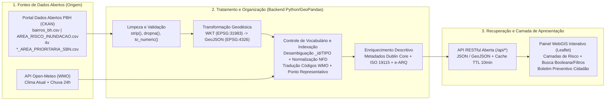
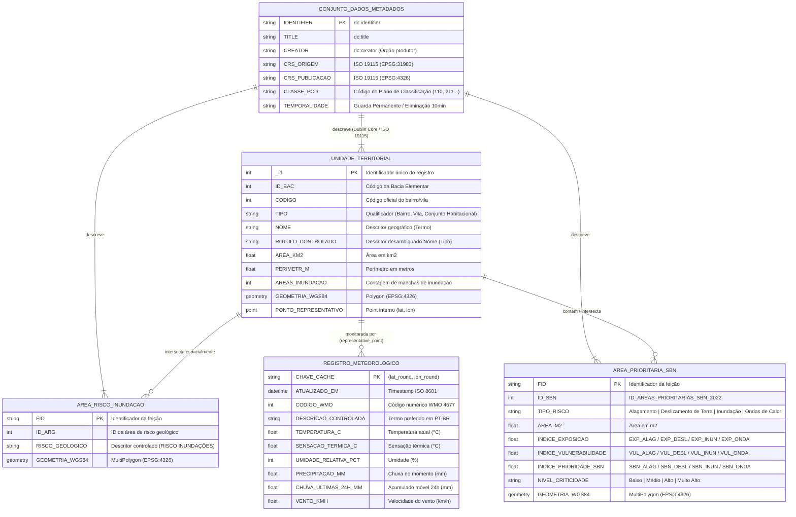

# ETAPA 2: DESENVOLVIMENTO DA SOLUÇÃO

## 2. Definição dos Requisitos

### 2.1 Principais Conceitos e Termos Utilizados na Aplicação

A tabela a seguir formaliza os conceitos nucleares da plataforma **RiscoAberto**:

| Termo Preferido (Descritor) | Definição Conceitual (Características Essenciais) | Referente no Sistema (`RiscoAberto`) | Termos Não-Preferidos / Siglas Relacionadas |
| :--- | :--- | :--- | :--- |
| **Unidade Territorial de Bairro** | Divisão territorial oficial ou popular do município delimitada por polígono georreferenciado. | Polígonos de `bairros_bh.csv` (`TIPO`: Bairro, Vila, Conjunto Habitacional). | Região, Localidade, Comunidade |
| **Risco Geológico-Hidrológico** | Probabilidade de ocorrência de processo destrutivo (inundação, alagamento, deslizamento) associada à vulnerabilidade local. | Feições de `AREA_RISCO_INUNDACAO.csv` e bases SBN (`EXP_*`, `VUL_*`). | Mancha de inundação, Ponto crítico, Área de risco |
| **Inundação** | Extravasamento das águas do canal normal de drenagem (córregos e rios) atingindo áreas marginais (planície de inundação). | Atributo `RISCO_GEOLOGICO = "RISCO INUNDAÇÕES"` e índice `EXP_INUN`. | Enchente, Cheia de córrego, Transbordamento fluvial |
| **Alagamento** | Acúmulo momentâneo de águas pluviais em vias ou perímetros urbanos por deficiência no sistema de drenagem, independente de extravasamento fluvial. | Base `ALAGAMENTO_AREA_PRIORITARIA_SBN.csv` (`EXP_ALAG`, `VUL_ALAG`). | Enxurrada urbana, Ponto de alagamento |
| **Deslizamento de Terra** | Movimento gravitacional de massa (solo, rocha ou aterro) em encostas íngremes deflagrado por saturação hídrica. | Base `DESLIZAMENTO_TERRA_AREA_PRIORITARIA_SBN.csv` (`EXP_DESL`, `VUL_DESL`). | Escorregamento de encosta, Desbarrancamento, Queda de barreira |
| **Onda de Calor** | Período prolongado de temperaturas excessivamente elevadas agravado pela impermeabilização e baixa arborização urbana (`CON_ANT`). | Base `ONDAS_CALOR_AREA_PRIORITARIA_SBN.csv` (`EXP_ONDA`, `VUL_ONDA`). | Ilha de calor urbana, Estresse térmico urbano, Calor extremo |
| **Soluções Baseadas na Natureza (SBN)** | Intervenções inspiradas e apoiadas na natureza (parques lineares, jardins de chuva, reflorestamento) para mitigação de riscos climáticos. | Índices de priorização `SBN_ALAG`, `SBN_DESL`, `SBN_INUN`, `SBN_ONDA`. | Infraestrutura verde, Drenagem sustentável |
| **Vulnerabilidade Socioambiental** | Grau de suscetibilidade de uma população ou território sofrer danos diante de uma ameaça climática (`VUL_*`, `AC_*`). | Índices `VUL_*` (Vulnerabilidade) e `AC_*` (Análise Multicritério) das bases da PBH. | Fragilidade territorial, Suscetibilidade social |

---

### 2.2 Requisitos Funcionais (RF) e Não-Funcionais (RNF)

#### A. Requisitos Funcionais (RF)
- **RF01 — Recuperação Geoespacial por Bairro e Controle de Homônimos:** Permitir a busca textual de unidades territoriais ignorando acentuação e caixa (alta/baixa), resolvendo homônimos entre *Bairro* e *Vila* através do identificador único (`_id`) e do qualificador tipológico (`TIPO`).
- **RF02 — Visualização em Camadas Temáticas:** Renderizar sobre o mapa base camadas independentes e combináveis de limites de bairros, manchas de risco de inundação e áreas prioritárias para Soluções Baseadas na Natureza (alagamento, deslizamento de terra, inundação e ondas de calor).
- **RF03 — Monitoramento Meteorológico Contextualizado:** Consultar e exibir em tempo real variáveis meteorológicas (temperatura, sensação térmica, umidade relativa, velocidade do vento, precipitação atual e precipitação acumulada nas últimas 24 horas) para o ponto representativo interno (`representative_point`) do polígono do bairro selecionado.
- **RF04 — Busca Avançada com Operadores Lógicos e Filtragem Facetada:** Permitir filtrar unidades territoriais combinando critérios temáticos (tipo de localidade e presença de risco de inundação) e operadores lógicos booleanos (`AND`/`E`, `OR`/`OU`, `NOT`/`NAO`).
- **RF05 — Geração de Boletim Preventivo Cidadão:** Traduzir os indicadores técnicos do bairro selecionado — obtidos pelo cruzamento espacial entre o polígono do bairro, as manchas de risco de inundação e as microáreas de vulnerabilidade SBN — em um boletim informativo em linguagem acessível para orientação preventiva da população.
- **RF06 — Disponibilização via API Aberta com Metadados Padronizados:** Expor endpoints RESTful (`/api/bairros/geojson`, `/api/areas-inundacao/geojson`, `/api/areas-sbn/<tipo>/geojson`, `/api/clima` e `/api/metadados`) em formato JSON/GeoJSON acompanhados de descritores **Dublin Core** e **ISO 19115** (Perfil de metadados Geoespaciais).

#### B. Requisitos Não-Funcionais (RNF)
- **RNF01 — Interoperabilidade Geoespacial (OGC / IETF):** Todas as geometrias expostas na API e consumidas pelo frontend devem ser convertidas do sistema projetado oficial brasileiro (`SIRGAS 2000 / UTM zone 23S - EPSG:31983`) para o padrão internacional web (`WGS84 - EPSG:4326`) segundo a especificação **RFC 7946 (GeoJSON)**.
- **RNF02 — Desempenho e Cache em Memória:** O processamento de arquivos CSV/WKT volumosos deve utilizar cache em memória (`@lru_cache`) e o serviço meteorológico deve manter tempo de vida (TTL) de 600 segundos por coordenada, evitando sobrecarga de serviços externos e garantindo tempo de resposta inferior a 500 ms em consultas subsequentes.
- **RNF03 — Segurança contra Injeção de Código (XSS):** Os popups, listas de sugestões e painéis informativos devem renderizar atributos vindos de bases externas utilizando manipulação segura de DOM (`textContent`), impedindo a execução de HTML ou scripts arbitrários.
- **RNF04 — Usabilidade e Linguagem Simples (Plain Language):** A interface deve apresentar tradução imediata de códigos técnicos (como códigos WMO 0–99 e índices numéricos `SBN_*`) para descritores em língua portuguesa compreensíveis por usuários não especialistas.

---

### 2.3 Requisitos de Gestão Arquivística

Com base no **e-ARQ Brasil (CONARQ, 2020)** — Modelo de Requisitos para Sistemas Informatizados de Gestão Arquivística de Documentos (SIGAD) —, o sistema observa os seguintes requisitos para assegurar que os registros de risco, malhas territoriais e séries climáticas mantenham autenticidade, integridade e valor informativo:

1. **Captura e Registro Padronizado (e-ARQ Seção 1):** Ingestão estruturada dos conjuntos de dados vindos do portal CKAN da Prefeitura de Belo Horizonte (DataBH/BHMap), preservando os identificadores únicos de origem (`FID`, `_id`, `ID_ARG`, `ID_AREAS_PRIORITARIAS_SBN_2022`) e os registros cronológicos (`atualizado_em` em padrão ISO 8601).
2. **Organicidade e Proveniência (Respeito aos Fundos):** Preservação explícita do vínculo arquivístico com a entidade produtora (Prefeitura de Belo Horizonte / PRODABEL / Subsecretaria de Proteção e Defesa Civil / SMMA / SUPLAN e Open-Meteo/INMET), distinguindo claramente dados cartográficos oficiais de estimativas de modelos meteorológicos por meio dos metadados `fonte` e `fonte_url`.
3. **Autenticidade, Integridade e Imutabilidade dos Dados Primários:** Os arquivos brutos em `data/` são mantidos como depósitos somente-leitura (*read-only*) no pipeline; todas as transformações (limpeza, reprojeção cartográfica e normalização lexical) ocorrem em memória para geração das visões derivadas, preservando a cadeia de custódia do documento arquivístico digital original.
4. **Rastreabilidade e Auditoria de Linhagem:** Documentação formal do fluxo de transformação cartográfica e indexação espacial (metadado de linhagem `gmd:LI_Lineage`), permitindo auditar a origem exata de cada diagnóstico territorial emitido pela plataforma.

---

## 3. Aplicação de Métodos e Técnicas de Organização da Informação

### 3.1 Fontes de Informação e Pipeline de Tratamento de Dados

A tabela a seguir detalha as fontes de dados abertos utilizadas pelo **RiscoAberto**, suas características originais e as regras de transformação, limpeza e conversão implementadas no módulo `app/utils.py` e `app/clima.py`:

| Fonte de Informação | Órgão Produtor / Origem | Formato Bruto e Padrões | Regras de Limpeza, Transformação e Conversão (ETL) |
| :--- | :--- | :--- | :--- |
| **Malha de Bairros de Belo Horizonte** (`bairros_bh.csv` / `apenas_bairros_bh.csv`) | PBH / PRODABEL (Portal Dados Abertos CKAN) | CSV (UTF-8), Geometria em **WKT** (*Well-Known Text*), CRS **EPSG:31983** (SIRGAS 2000 / UTM 23S). | 1. Higienização de espaços nos cabeçalhos (`str.strip()`). 2. Conversão de tipos numéricos (`AREA_KM2`, `PERIMETR_M`) com coerção de inconsistências (`pd.to_numeric(..., errors="coerce")`). 3. Conversão de strings WKT (`POLYGON`) para objetos geométricos via `shapely.wkt.loads`. 4. Reprojeção cartográfica de `EPSG:31983` para `EPSG:4326` (WGS84). 5. Cálculo de ponto interno (`representative_point()`) para consulta meteorológica. 6. Desambiguação de homônimos com qualificador `ROTULO_CONTROLADO` e precedência para `TIPO == "Bairro"`. |
| **Áreas de Risco de Inundação** (`AREA_RISCO_INUNDACAO.csv`) | PBH / Defesa Civil / SUDECAP (BHMap / CKAN) | CSV, Geometria `MULTIPOLYGON` em **WKT**, CRS **EPSG:31983**. | 1. Validação de esquema (verificação das colunas obrigatórias `FID`, `ID_ARG`, `RISCO_GEOLOGICO`, `GEOMETRIA`). 2. Remoção de registros órfãos de geometria (`dropna(subset=["GEOMETRIA"])`). 3. Conversão WKT $\rightarrow$ Shapely $\rightarrow$ Reprojeção `EPSG:4326` $\rightarrow$ Serialização `GeoJSON`. |
| **Áreas Prioritárias para SBN (Alagamento, Deslizamento, Inundação, Ondas de Calor)** (`*_AREA_PRIORITARIA_SBN.csv`) | PBH / SMMA / SUPLAN (Estudo de Vulnerabilidade Climática 2022) | 4 arquivos CSV, Geometria `MULTIPOLYGON` em **WKT**, CRS **EPSG:31983**, índices contínuos (0 a 5). | 1. Conversão numérica e filtragem de microáreas com índice de prioridade ativo (`SBN_* > 0`). 2. Integração temática das 4 dimensões de ameaça climática por chave `ID_AREAS_PRIORITARIAS_SBN_2022`. 3. Categorização dos índices contínuos em classes controladas de criticidade (`Baixo`, `Médio`, `Alto`, `Muito Alto`) e reprojeção para `EPSG:4326`. |
| **Condições Meteorológicas e Precipitação** (`api.open-meteo.com/v1/forecast`) | Open-Meteo / Modelos Meteorológicos (padrão WMO) | JSON via API REST HTTPS; Fuso `America/Sao_Paulo` (ISO 8601); Códigos numéricos **WMO Code 4677**. | 1. Validação de caixa delimitadora (*Bounding Box*) municipal (`lat` entre `-20.08` e `-19.75`; `lon` entre `-44.08` e `-43.84`). 2. Soma móvel da série horária (`hourly.precipitation`) nas 24 horas imediatamente anteriores ao timestamp da coleta. 3. Tradução semântica do `weather_code` WMO para descritor controlado em português. |

---

### 3.2 Tratamento Temático da Informação (TTI)

As técnicas de tratamento temático implementadas na solução fundamentam-se na literatura clássica da Ciência da Informação:

#### A. Teoria da Classificação — Classificação Facetada (Ranganathan, 1967) e Taxonomia de Riscos
O domínio do **RiscoAberto** foi estruturado segundo as cinco categorias fundamentais **PMEST** (Personalidade, Matéria, Energia, Espaço e Tempo):

- **[P] Personalidade (Unidade Territorial):** Município de Belo Horizonte $\rightarrow$ Bacia Elementar (`ID_BAC`) $\rightarrow$ Tipologia de Localidade (`TIPO`: Bairro, Vila, Conjunto Habitacional) $\rightarrow$ Unidade Territorial (`NOME` / `_id`).
- **[M] Matéria (Componentes e Índices Territoriais):** Condição Ambiental (`CON_AMB`), Condição Antrópica (`CON_ANT`), Índice de Exposição (`EXP_*`), Índice de Vulnerabilidade (`VUL_*`) e Dimensões Físicas (`AREA_KM2`, `PERIMETR_M`).
- **[E] Energia (Processos e Eventos Adversos — Taxonomia alinhada à COBRADE):**
  - *Processos Hidrológicos:* Inundação (`RISCO INUNDAÇÕES` / `SBN_INUN`) e Alagamento (`SBN_ALAG`).
  - *Processos Geológicos / Movimentos de Massa:* Deslizamento de Terra (`SBN_DESL`).
  - *Processos Climatológicos e Meteorológicos:* Onda de Calor (`SBN_ONDA`) e Eventos Pluviométricos (`WMO 51–99`).
- **[S] Espaço (Referência Geodésica):** Representação vetorial em polígonos e multipolígonos (`EPSG:31983` na análise espacial e `EPSG:4326` na camada de visualização).
- **[T] Tempo (Recorte Temporal):** Condição meteorológica instantânea (`atualizado_em`), janela móvel acumulada de 24 horas (`chuva_ultimas_24h_mm`) e ano-base do mapeamento de vulnerabilidade (`2022`).

#### B. Controle de Vocabulário — Tesauro Funcional e Controle de Homógrafos (Lancaster, 2004; ANSI/NISO Z39.19)
Três instrumentos foram implementados no sistema:

1. **Controle de Homógrafos Geográficos com Qualificadores Parentéticos:** A base oficial de abairramento de Belo Horizonte contém **20 designações homônimas** entre categorias distintas (ex.: `Califórnia` existe como *Bairro* no `_id: 217` e como *Vila* no `_id: 138`; o mesmo ocorre com `Marçola`, `São José`, `do Barreiro`, entre outros). Seguindo as diretrizes da ANSI/NISO Z39.19 para desambiguação de homógrafos, o sistema gera o descritor qualificado `ROTULO_CONTROLADO` (ex.: `Califórnia (Bairro)` vs. `Califórnia (Vila)`), associa cada entidade ao seu identificador canônico (`_id`) e define regra de precedência para o tipo oficial `"Bairro"` em buscas não qualificadas.
2. **Estrutura Relacional do Tesauro Simplificado (TG, TE, TR, UP/USE):**
   - **TG (Termo Genérico):** `Desastres Socioambientais Urbanos`
     - **TE (Termo Específico):** `Desastres Hidrológicos`
       - **TE:** `Inundação` | **UP (Usado Para):** *Enchente*, *Cheia fluvial*, *Transbordamento de córrego* | **TR (Termo Relacionado):** `Alagamento`, `Soluções Baseadas na Natureza (SBN)`
       - **TE:** `Alagamento` | **UP:** *Enxurrada urbana*, *Acúmulo de água na via* | **TR:** `Inundação`, `Drenagem Urbana`
     - **TE:** `Desastres Geológicos`
       - **TE:** `Deslizamento de Terra` | **UP:** *Escorregamento de encosta*, *Desbarrancamento*, *Queda de barreira* | **TR:** `Precipitação Acumulada 24h`
     - **TE:** `Desastres Climatológicos`
       - **TE:** `Onda de Calor` | **UP:** *Ilha de calor urbana*, *Calor extremo* | **TR:** `Condição Antrópica`, `Soluções Baseadas na Natureza (SBN)`
3. **Tabela de Equivalência Terminológica Meteorológica (WMO Code 4677):** O dicionário `DESCRICOES_WMO` (`app/clima.py`) atua como tabela de tradução controlada que converte 28 códigos numéricos internacionais da Organização Meteorológica Mundial para descritores padronizados em língua portuguesa (ex.: código `80` $\rightarrow$ `"Pancadas de chuva fracas"`).

#### C. Indexação — Indexação Automática por Extração Lexical e Atribuição Espacial (Lancaster, 2004)
No **RiscoAberto**, aplica-se a **indexação automática híbrida**:
1. **Indexação Automática por Extração Normalizada:** A função `_normalizar_nome()` executa decomposição canônica Unicode (`NFD`), remoção de marcas diacríticas (acentos e cedilha), conversão para minúsculas (*case-folding*) e padronização de espaços, estruturando os dicionários de índice em memória (`por_id` e `por_nome`).
2. **Indexação Automática por Atribuição Geoespacial (*Spatial Indexing*):** Por meio do predicado topológico `intersects` (biblioteca `GeoPandas`/`Shapely`), o sistema analisa geometricamente cada polígono de bairro contra os polígonos de inundação e as microáreas SBN, atribuindo automaticamente ao bairro a quantidade de manchas de risco (`AREAS_INUNDACAO`) e os descritores de criticidade (`Baixo`, `Médio`, `Alto`, `Muito Alto`).

---

### 3.3 Tratamento Descritivo da Informação (TDI) e Padrões de Metadados

Para garantir a descoberta de recursos na Web e a interoperabilidade cartográfica, a solução adota um **perfil de aplicação híbrido** (exposto no endpoint `/api/metadados`), combinando dois padrões internacionais:
1. **Dublin Core (ISO 15836 / ANSI/NISO Z39.85):** Utilizado para a descrição administrativa, autoral, temática e de direitos dos conjuntos de dados abertos.
2. **ISO 19115:2014 / Perfil MGB 2.0 (Metadados Geoespaciais do Brasil — CONCAR/INDE):** Adotado para descrever especificidades de objetos vetoriais geográficos, como o Sistema de Referência de Coordenadas (CRS), o tipo de representação espacial, a caixa delimitadora geográfica (*Bounding Box*) e a linhagem de processamento (*Lineage*).

#### Tabela Detalhada de Metadados Adotados no `RiscoAberto`:

| Elemento / Campo no Sistema | Padrão de Origem | Propriedade Padronizada | Tipo / Formato de Dados | Descrição e Conteúdo no `RiscoAberto` |
| :--- | :--- | :--- | :--- | :--- |
| `dc:title` | Dublin Core | `Title` | `String` (UTF-8) | *"RiscoAberto — Plataforma Geoespacial de Riscos Hidrogeológicos e Climáticos de Belo Horizonte"* |
| `dc:creator` | Dublin Core | `Creator` | `Array<String>` | *"Prefeitura Municipal de Belo Horizonte (PRODABEL / BHGeo / DataBH)"*, *"Subsecretaria de Proteção e Defesa Civil"*, *"SMMA / SUPLAN"* |
| `dc:subject` | Dublin Core | `Subject` | `Array<String>` | `["Inundação", "Alagamento", "Deslizamento de Terra", "Onda de Calor", "Soluções Baseadas na Natureza (SBN)", "Vulnerabilidade Socioambiental", "Defesa Civil"]` |
| `dc:description` | Dublin Core | `Description` | `String` | Conjunto integrado de dados geoespaciais e meteorológicos normalizados para prevenção de desastres socioambientais em Belo Horizonte. |
| `dc:publisher` | Dublin Core | `Publisher` | `String` | *"Plataforma RiscoAberto"* |
| `dc:date` / `atualizado_em` | Dublin Core | `Date` | `ISO 8601` (`YYYY-MM-DDThh:mm`) | Data de referência dos mapeamentos (`2022`/`2026`) e carimbo de tempo das coletas meteorológicas instantâneas. |
| `dc:type` | Dublin Core | `Type` | `DCMI Type Vocabulary` | `Dataset` / `InteractiveResource` / `Service` |
| `dc:format` | Dublin Core | `Format` | `IANA MIME Type` | `application/geo+json` (RFC 7946), `application/json`, `text/csv` |
| `dc:identifier` | Dublin Core | `Identifier` | `String` / `URI` | Identificador da coleção (`urn:ufmg:oti071:riscoaberto:bh:2026`) e chaves primárias das feições (`_id`, `FID`, `ID_ARG`, `ID_SBN`). |
| `dc:source` | Dublin Core | `Source` | `Array<URI>` | `https://dados.pbh.gov.br/` e `https://api.open-meteo.com/v1/forecast` |
| `dc:language` | Dublin Core | `Language` | `RFC 5646` | `pt-BR` |
| `dc:coverage` | Dublin Core | `Coverage` | `String` | *"Belo Horizonte, Minas Gerais, Brasil"* |
| `dc:rights` | Dublin Core | `Rights` | `String` | *"Creative Commons Attribution 4.0 International (CC-BY 4.0) / Dados Abertos Governamentais"* |
| `gmd:referenceSystemInfo` | ISO 19115 (MGB) | `CRS / SRS` | `EPSG Code` | Origem: `EPSG:31983` (SIRGAS 2000 / UTM zone 23S) $\rightarrow$ Publicação: `EPSG:4326` (WGS84). |
| `gmd:spatialRepresentationType` | ISO 19115 (MGB) | `Spatial Representation` | `MD_SpatialRepresentationTypeCode` | `vector` (Feições topológicas `Polygon`, `MultiPolygon` e `Point`). |
| `gmd:EX_GeographicBoundingBox` | ISO 19115 (MGB) | `Bounding Box` | `Object<Float>` | `west: -44.08`, `south: -20.08`, `east: -43.84`, `north: -19.75`. |
| `gmd:LI_Lineage` | ISO 19115 (MGB) | `Lineage` (Linhagem) | `String` | Ingestão CSV/WKT $\rightarrow$ Limpeza e validação $\rightarrow$ Conversão Shapely (`EPSG:31983`) $\rightarrow$ Ponto representativo e interseção espacial $\rightarrow$ Reprojeção GeoJSON (`EPSG:4326`). |

---

### 3.4 Instrumentos e Funcionalidades da Gestão Arquivística

A gestão arquivística dos documentos e conjuntos de dados digitais do **RiscoAberto** fundamenta-se nos princípios arquivísticos clássicos (**Rousseau & Couture, 1998; Bellotto, 2006**) e nas diretrizes do **CONARQ (e-ARQ Brasil)**:

#### A. Princípios Arquivísticos Observados
- **Princípio da Proveniência (Respeito aos Fundos):** Os conjuntos de dados mantêm a identificação de sua origem institucional (PRODABEL, Defesa Civil, SMMA/SUPLAN e Open-Meteo), preservando os identificadores originais de cada produtor (`_id`, `FID`, `ID_ARG`).
- **Princípio da Organicidade:** As séries documentais refletem diretamente as funções e atividades de gestão territorial, monitoramento climático e defesa civil do município.
- **Princípio da Indivisibilidade e Integridade:** Os atributos descritivos e suas respectivas geometrias vetoriais (`GEOMETRIA`) são mantidos indissociáveis durante todo o ciclo de vida documental.

#### B. Plano de Classificação Documental (PCD)
Estrutura hierárquica funcional para organização dos documentos digitais da plataforma:
- **Classe `100` — Base Cartográfica e Divisão Territorial Oficial**
  - `110` — Malha Oficial de Bairros, Vilas e Conjuntos Habitacionais (`bairros_bh.csv` / `apenas_bairros_bh.csv`)
  - `120` — Bacias Hidrográficas Elementares (`ID_BAC`)
- **Classe `200` — Mapeamento de Riscos e Vulnerabilidades Socioambientais**
  - `210` — Riscos Hidrológicos
    - `211` — Áreas de Risco de Inundação (`AREA_RISCO_INUNDACAO.csv`)
    - `212` — Áreas Prioritárias SBN — Inundação (`INUNDACAO_AREA_PRIORITARIA_SBN.csv`)
    - `213` — Áreas Prioritárias SBN — Alagamento (`ALAGAMENTO_AREA_PRIORITARIA_SBN.csv`)
  - `220` — Riscos Geológicos
    - `221` — Áreas Prioritárias SBN — Deslizamento de Terra (`DESLIZAMENTO_TERRA_AREA_PRIORITARIA_SBN.csv`)
  - `230` — Riscos Climatológicos e Térmicos
    - `231` — Áreas Prioritárias SBN — Ondas de Calor (`ONDAS_CALOR_AREA_PRIORITARIA_SBN.csv`)
- **Classe `300` — Monitoramento Meteorológico e Diagnósticos Preventivos**
  - `310` — Coletas Meteorológicas Instantâneas e Acumulados de 24h em Cache (`app/clima.py`)
  - `320` — Boletins Preventivos e Diagnósticos Territoriais Consolidados (`app/utils.py`)

#### C. Tabela de Temporalidade e Destinação de Documentos (TTDD)

| Código PCD | Série Documental / Conjunto de Dados | Prazo de Guarda: Fase Corrente | Prazo de Guarda: Fase Intermediária | Destinação Final | Justificativa Arquivística e Legal |
| :--- | :--- | :--- | :--- | :--- | :--- |
| **`110`** | Malha Oficial de Bairros, Vilas e Conjuntos de BH | Vigência da legislação municipal de abairramento | Não se aplica | **Guarda Permanente** | Valor histórico, probatório e cartográfico para o estudo da evolução urbana do município. |
| **`211` a `231`** | Mapas de Risco Geológico e Áreas Prioritárias SBN | Vigência do Plano Diretor / Revisão Plurianual (4 anos) | 10 anos (para análise de séries históricas decenais) | **Guarda Permanente** | Valor científico, ambiental e probatório para avaliação de políticas públicas de mitigação climática. |
| **`310`** | Coletas Meteorológicas Instantâneas em Cache (`_cache`) | **10 minutos** (`CACHE_SEGUNDOS = 600`) | Sem guarda intermediária | **Eliminação Imediata** (expiração automática de cache) | Registro efêmero de estimativa de modelo numérico; as séries meteorológicas definitivas são custodiadas pelos órgãos oficiais (INMET). |
| **`320`** | Logs Operacionais e Boletins Preventivos Emitidos | 2 anos | 3 anos | **Eliminação** (após consolidação estatística) ou **Guarda Permanente** (em episódios de calamidade pública) | Atendimento aos prazos de transparência administrativa e auditoria (Lei de Acesso à Informação — Lei nº 12.527/2011). |

---

## 4. Modelo de Recuperação da Informação

### 4.1 Recursos de Recuperação, Filtros e Operadores Lógicos

O subsistema de recuperação da informação do **RiscoAberto** fundamenta-se no **Modelo Booleano Estendido combinado à Navegação Facetada e Recuperação Espacial (Baeza-Yates & Ribeiro-Neto, 2013)**, disponibilizando os seguintes recursos:

1. **Pré-processamento e Normalização Lexical:**
   - Tanto os documentos indexados quanto as expressões de busca do usuário passam por decomposição Unicode (`NFD`), supressão de diacríticos, conversão para caixa baixa e remoção de espaços excedentes. Dessa forma, buscas por `"lindeia"`, `"Lindéia"` ou `"LINDEIA"` apresentam revocação consistente.
2. **Operadores Lógicos Booleanos (`AND`, `OR`, `NOT`):**
   - O avaliador de consultas (`avaliarConsultaBooleana`) suporta expressões booleanas em inglês e português:
     - **Operador `AND` (`E` / Interseção lógica $\cap$):** Recupera registros que contenham simultaneamente todos os termos especificados (comportamento padrão entre termos adjacentes ou separados por `AND`/`E`, ex.: `Califórnia AND Vila`).
     - **Operador `OR` (`OU` / União lógica $\cup$):** Amplia a revocação (*recall*) permitindo recuperar múltiplas localidades na mesma consulta (ex.: `Barreiro OR Lindeia`).
     - **Operador `NOT` (`NAO` ou prefixo `-` / Diferença lógica $-$):** Exclui explicitamente registros que contenham o termo indesejado, permitindo refinar a precisão em casos de homonímia (ex.: `California NOT Vila` ou `California -Vila`).
3. **Filtros Facetados Combináveis:**
   - **Filtro por Qualificador Tipológico (`TIPO`):** Permite restringir o universo de busca a *Todos*, *Apenas Bairros Oficiais*, *Apenas Vilas* ou *Apenas Conjuntos Habitacionais*.
   - **Filtro Espacial de Risco (`TEM_RISCO_INUNDACAO`):** Caixa de seleção que filtra exclusivamente as unidades territoriais cujo polígono intersecta manchas oficiais de risco de inundação mapeadas pela Defesa Civil (`AREAS_INUNDACAO > 0`).
4. **Recuperação Multicanal na API (`/api/clima` e `/api/bairros/selecionado`):**
   - Suporte a recuperação por identificador canônico (`?id=217`), por descritor textual (`?bairro=Califórnia`) e por consulta espacial de coordenadas geográficas (`?lat=-19.93&lon=-43.94`).

---

## 5. Modelagem e Desenvolvimento da Solução

### 5.1 Pipeline de Dados e Modelo Entidade-Relacionamento (MER)

#### A. Pipeline de Dados e Processos

#### B. Modelo Entidade-Relacionamento (MER / DER)

---

### 5.2 Síntese das Funcionalidades Implementadas na Solução

A implementação funcional do protótipo encontra-se estruturada no diretório `RiscoAberto/` e contempla:
1. **Motor de Processamento Geoespacial e Cruzamento Topológico (`app/utils.py`):** Leitura e higienização das bases CSV/WKT, conversão de projeção cartográfica (`EPSG:31983` $\rightarrow$ `EPSG:4326`), desambiguação de bairros homônimos, interseção geométrica entre bairros, manchas de inundação e microáreas SBN, e geração automatizada do boletim preventivo cidadão.
2. **Serviço de Integração Climática (`app/clima.py`):** Consulta por ponto representativo interno de cada polígono à API Open-Meteo, validação de limites geográficos de Belo Horizonte, cálculo de precipitação acumulada em 24 horas, cache em memória com TTL de 10 minutos e tradução terminológica dos códigos WMO.
3. **API Aberta e Catálogo de Metadados (`app/routes.py`):** Endpoints RESTful que servem as malhas em GeoJSON (`/api/bairros/geojson`, `/api/areas-inundacao/geojson`, `/api/areas-sbn/<tipo>/geojson`), o diagnóstico territorial (`/api/bairros/selecionado`), os dados meteorológicos (`/api/clima`) e o catálogo descritivo completo (`/api/metadados`).
4. **Interface WebGIS Interativa (`app/templates/pagina.html`):** Mapa interativo em Leaflet com controle de camadas temáticas, barra de busca avançada com suporte a operadores booleanos (`AND`, `OR`, `NOT`) e filtros facetados, seleção direta no mapa, painel de boletim preventivo e visualizador de metadados Dublin Core / ISO 19115 / e-ARQ Brasil.

---
